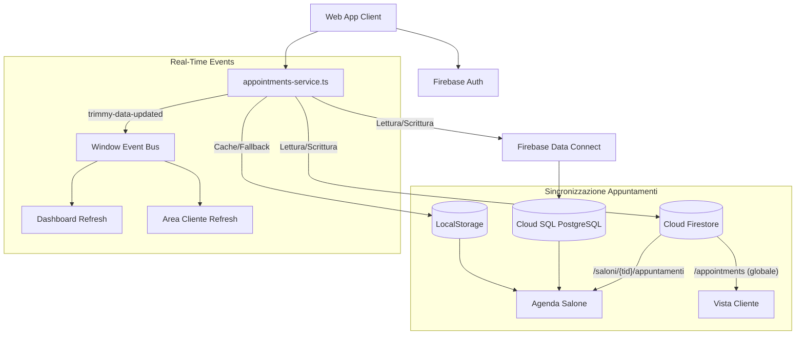
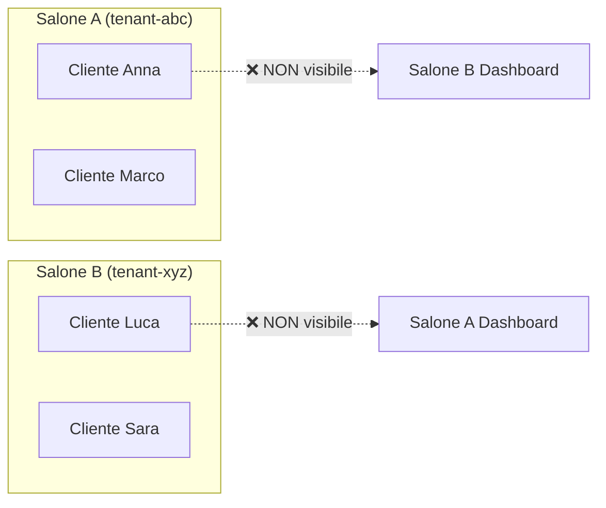

# ✂️ Trimmy — Gestionale per Saloni & Barber Shop

> Piattaforma SaaS multi-tenant cloud-native per parrucchieri, barbieri e centri estetici.
> Agenda appuntamenti sincronizzata su tre fonti dati, CRM clienti isolato per tenant, marketplace con Google Maps, gestione staff e abbonamenti scalabili.

🌐 **Web App Live**: [https://trimmy--gestionale-saloni.europe-west4.hosted.app](https://trimmy--gestionale-saloni.europe-west4.hosted.app)
🚀 **Ambiente Cloud**: Firebase App Hosting (`europe-west4`) + Cloud SQL PostgreSQL (`europe-west8`) + Cloud Firestore (`europe-west4`).

---

## 📌 Indice

- [Caratteristiche Principali](#-caratteristiche-principali)
- [Architettura Tri-Source Sync](#-architettura-tri-source-sync)
- [Multi-Tenant e Isolamento Dati](#-multi-tenant-e-isolamento-dati)
- [Piani di Abbonamento](#-piani-di-abbonamento)
- [Struttura del Progetto](#-struttura-del-progetto)
- [Avvio e Sviluppo Locale](#-avvio-e-sviluppo-locale)
- [Comandi di Deploy e Gestione Cloud](#-comandi-di-deploy-e-gestione-cloud)
- [Compatibilità Browser](#-compatibilità-browser)
- [Roadmap Futura](#-roadmap-futura)

---

## 🌟 Caratteristiche Principali

### 🏢 Lato Salone (Gestionale SaaS)

- **📅 Agenda Multivista Sincronizzata**: Visualizzazione Giornaliera, Settimanale, Mensile e Vista Operatori/Staff. Gli appuntamenti creati dal salone o prenotati dai clienti appaiono istantaneamente grazie alla **sincronizzazione tri-source** (Firestore + Cloud SQL + LocalStorage).
- **👥 CRM Clienti Multi-Tenant**: Schede anagrafiche complete con telefono, email, data di nascita, storico appuntamenti e note tecniche. **I clienti di un salone sono completamente isolati** e non visibili ad altri saloni.
- **🆕 Aggiunta Appuntamenti Intelligente**: Quando il salone crea un appuntamento, il sistema verifica se il cliente è già registrato nella piattaforma. Se il cliente non esiste, viene creato automaticamente un nuovo account Cliente completo (email, telefono, nome) direttamente nel database, senza richiedere registrazione esterna.
- **🔐 Autenticazione & Onboarding**:
  - Accesso tramite **Google Sign-In** ed **Email / Password**.
  - Rilevamento automatico del ruolo (**Salone** vs **Cliente**).
  - Modal onboarding con raccolta dati aziendali: Nome Salone, Categoria, **Partita IVA** e **Numero di Collaboratori** con calcolo istantaneo del piano adeguato.
- **✂️ Listino Servizi & Trattamenti Persistente**: Configurazione prezzi, durata e descrizione trattamenti con persistenza istantanea su Cloud Firestore e LocalStorage. I trattamenti creati e modificati resistono all'aggiornamento pagina (F5).
- **👨‍💼 Gestione Staff con Controllo Abbonamento**: L'aggiunta di nuovi membri dello staff è **vincolata al piano di abbonamento attivo**. Se il salone supera il limite del piano, viene mostrato un avviso di upgrade. L'invito ai nuovi membri avviene via email reale con link di partecipazione.
- **🔔 Notifiche Intelligenti**: Sistema di notifiche in-app che mostra **solo notifiche effettive** (nuove prenotazioni, cancellazioni, modifiche) senza falsi positivi, con badge contador in tempo reale.
- **⚙️ Profilo Salone & Upgrade Abbonamento SaaS**:
  - Sezione Dettagli Salone con indirizzo fisico, città, categoria e telefono sincronizzati con il marketplace.
  - Flusso di upgrade abbonamento (*Starter* -> *Medium* -> *Pro* o switch tra piani) con sblocco immediato e reindirizzamento automatico all'Agenda.

### 💎 Lato Cliente (Marketplace, Mappa & Area Personale)

- **🔍 Ricerca Smart & Marketplace**: Barra di ricerca avanzata con autocompletamento intelligente per nome, categoria, città e servizio. Visualizzazione dei saloni realmente registrati con listino prezzi reale e distanza.
- **📍 Pulsante "Vicino a me"**: Usa la **geolocalizzazione del browser** per calcolare la distanza in km dal cliente a ciascun salone e ordinarli per vicinanza.
- **🗺️ Integrazione Google Maps con Vista Stradale**:
  - Supporto nativo a `NEXT_PUBLIC_GOOGLE_MAPS_API_KEY` con visualizzazione Google Maps in stile stradale classico (vista predefinita).
  - Switch ad alta risoluzione disponibile.
  - Fallback cartografico ad alta fedeltà con pin interattivi, calcolo GPS su coordinate reali, controlli di zoom/pan e link diretto *"Apri in Google Maps"* — testabile anche senza API Key.
- **🗄️ Sidebar di Navigazione Completa**: Barra laterale con tutte le opzioni dell'area cliente (Dashboard, I Miei Appuntamenti, Cerca Saloni, Mappa, Profilo, Impostazioni) per una navigazione fluida e organizzata.
- **👤 Area Personale Cliente**:
  - Gestione del proprio profilo con Nome Completo, Telefono per notifiche WhatsApp, Città/Zona preferita e Note di Bellezza (preferenze taglio, sfumatura, barba, prodotti).
  - Precompilazione automatica del Wizard di Prenotazione con i dati del profilo.
- **📱 QR Code da Bancone & Link Diretto**: Generazione e condivisione di QR Code stilizzati e link dedicati (`/prenota?salone=...`) per permettere ai clienti di prenotare in 3 secondi senza scaricare alcuna app.
- **✨ Booking Wizard in 4 Step**: Scelta trattamento dal listino verificato, selezione dello stylist di fiducia, scelta data e orari liberi con slot in tempo reale, e riepilogo con conferma immediata. **La prenotazione appare istantaneamente nell'agenda del salone** e nell'area personale del cliente.
- **📆 Integrazione Calendario Personale**: Sincronizzazione con 1 click su **Google Calendar** e download del file standard **.ics** (per Apple Calendar e Microsoft Outlook).
- **🎫 VIP Boarding Pass Card**: Visualizzazione appuntamenti imminenti con countdown, indicazioni stradali, disdetta immediata e cronologia con funzione *"Riprenota al volo"* e recensioni a 5 stelle.

---

## 🗄️ Architettura Tri-Source Sync

Il sistema sincronizza gli appuntamenti su **tre fonti dati** per garantire consistenza immediata e resilienza:



### Flusso di Sincronizzazione

1. **Scrittura**: `saveSalonAppointment()` scrive contemporaneamente su Firestore subcollection (`/saloni/{tid}/appuntamenti`), Firestore globale (`/appointments`), Cloud SQL via Data Connect e LocalStorage.
2. **Lettura**: `fetchSalonAppointments()` legge da tutte le fonti e unisce i risultati eliminando duplicati per `id`.
3. **Real-Time**: Ogni modifica emette l'evento `trimmy-data-updated` sulla Window, forzando il refresh istantaneo di agenda, lista clienti e area personale.
4. **Resilienza**: Se una fonte è temporaneamente non disponibile, le altre garantiscono continuità operativa.

---

## 🔒 Multi-Tenant e Isolamento Dati



- **Tenant UUID**: Ogni salone opera sotto un `tenantId` univoco. I dati dei clienti e degli appuntamenti sono filtrati per tenant a livello di query.
- **Customer Mapping Duale**: Il modulo `customers-store.ts` risolve i clienti sia tramite `tenantId` che tramite il `Firebase Auth UID` grezzo, garantendo che le prenotazioni dei clienti vengano sempre associate correttamente al salone giusto.
- **Isolamento Completo**: Le query CRM e agenda includono sempre la clausola tenant, impedendo la fuga di dati tra saloni diversi.

---

## 💳 Piani di Abbonamento

Il gestionale adotta un modello di pricing automatico basato sulle dimensioni dello staff:

| Piano | Prezzo Mensile | Prezzo Annuale (-20%) | Limite Collaboratori | Funzionalità |
| :--- | :---: | :---: | :---: | :--- |
| **Starter** | **Gratis** | **Gratis** | 1 persona | Agenda base, clienti, listino servizi |
| **Medium** | **11,99 €** /mese | **115,99 €** /anno | Fino a 3 persone | Agenda multivista, note tecniche, promemoria |
| **Pro** | **39,00 €** /mese | **374,40 €** /anno | **Illimitati** (4+) | Collaboratori illimitati, statistiche avanzate |

### Controllo Staff Gated

Quando un salone tenta di aggiungere un membro dello staff oltre il limite consentito dal piano attivo, il sistema:
1. **Blocca l'aggiunta** e mostra un avviso chiaro.
2. **Suggerisce l'upgrade** al piano superiore con link diretto alla pagina di upgrade.
3. **L'invito email** viene inviato realmente alla casella del destinatario (se l'indirizzo è valido).

---

## 📁 Struttura del Progetto

```text
Gestionale saloni/
├── README.md                               # Documentazione completa del progetto
├── Backend/
│   ├── firebase.json                       # Configurazione Firebase (App Hosting, Firestore, Data Connect)
│   ├── firestore.rules                     # Regole di sicurezza Cloud Firestore
│   ├── dataconnect/
│   │   ├── dataconnect.yaml                # Configurazione servizio SQL Connect
│   │   ├── schema/
│   │   │   └── schema.gql                  # Schema tabelle GraphQL / PostgreSQL
│   │   └── example/
│   │       ├── connector.yaml              # Configurazione SDK JavaScript
│   │       ├── queries.gql                 # Query appuntamenti e risorse
│   │       ├── mutations.gql               # Mutazioni dati, appuntamenti e tenant
│   │       ├── appointments.gql            # Operazioni agenda e staff
│   │       └── customers.gql              # Operazioni anagrafica clienti
│   └── web-app/                            # Applicazione Web Next.js 16 (App Router)
│       ├── package.json
│       ├── next.config.ts
│       └── src/
│           ├── app/
│           │   ├── (dashboard)/            # Layout protetto gestionale salone
│           │   │   ├── page.tsx            # Agenda multivista sincronizzata
│           │   │   ├── layout.tsx          # Layout con Sidebar salone
│           │   │   ├── clienti/            # CRM Clienti multi-tenant
│           │   │   ├── trattamenti/        # Listino servizi e trattamenti
│           │   │   ├── impostazioni/       # Profilo salone e configurazione
│           │   │   └── statistiche/        # Dashboard statistiche
│           │   ├── login/                  # Accesso, registrazione e onboarding
│           │   ├── auth/                   # Callback autenticazione
│           │   ├── cliente/               # Area personale cliente con sidebar
│           │   ├── prenota/               # Prenotazione diretta tramite QR/link
│           │   ├── onboarding/            # Wizard configurazione iniziale salone
│           │   └── abbonamento-pro/       # Upgrade e gestione piano
│           ├── components/
│           │   ├── BookingWizardModal.tsx   # Wizard prenotazione 4 step con sync
│           │   ├── ClientSidebar.tsx       # Sidebar navigazione area cliente
│           │   ├── HeaderSearch.tsx        # Barra ricerca smart con filtri
│           │   ├── InteractiveSalonMap.tsx # Google Maps + fallback interattivo
│           │   ├── MobileBottomNav.tsx     # Navigazione bottom mobile
│           │   ├── NotificationBell.tsx    # Campanella notifiche intelligenti
│           │   ├── ReviewModal.tsx         # Modal recensioni 5 stelle
│           │   ├── SalonShareModal.tsx     # QR Code e condivisione salone
│           │   └── Sidebar.tsx            # Sidebar navigazione salone
│           ├── lib/
│           │   ├── firebase.ts             # Inizializzazione Firebase Auth, Firestore e Data Connect
│           │   ├── appointments-service.ts # ⭐ Sincronizzazione tri-source appuntamenti
│           │   ├── customers-store.ts      # CRM multi-tenant con mapping duale UID/tenant
│           │   ├── client-booking.ts       # Logica prenotazione lato cliente
│           │   ├── salon-notifications.ts  # Gestione notifiche reali salone
│           │   ├── salons-service.ts       # Servizio ricerca e dettagli saloni
│           │   ├── services-store.ts       # Persistenza listino trattamenti
│           │   ├── staff-store.ts          # Gestione staff con gating abbonamento
│           │   ├── tenant-helper.ts        # Helper per tenant UUID e isolamento
│           │   ├── user-profile.ts         # Profili utente, calcolo piani e sync
│           │   ├── date-utils.ts           # Utility date e formattazione
│           │   └── onboarding-templates.ts # Template dati onboarding iniziale
│           └── dataconnect-generated/      # SDK client GraphQL autogenerato
└── Frontend/                               # Spazio riservato a future espansioni / App mobile
```

---

## 💻 Avvio e Sviluppo Locale

### Prerequisiti
- **Node.js** v20 o superiore
- **npm** o **pnpm**
- **Firebase CLI** (`npm install -g firebase-tools` oppure via `npx`)

### 1. Installazione Dipendenze
```bash
cd Backend/web-app
npm install
```

### 2. Variabili d'Ambiente
Crea un file `.env.local` in `Backend/web-app/` con le seguenti chiavi:
```env
NEXT_PUBLIC_FIREBASE_API_KEY=...
NEXT_PUBLIC_FIREBASE_AUTH_DOMAIN=...
NEXT_PUBLIC_FIREBASE_PROJECT_ID=gestionale-saloni
NEXT_PUBLIC_FIREBASE_STORAGE_BUCKET=...
NEXT_PUBLIC_FIREBASE_MESSAGING_SENDER_ID=...
NEXT_PUBLIC_FIREBASE_APP_ID=...
NEXT_PUBLIC_GOOGLE_MAPS_API_KEY=...   # Opzionale: abilita Google Maps (senza → fallback interattivo)
```

### 3. Avvio del Server di Sviluppo
```bash
cd Backend/web-app
npm run dev
```
L'applicazione sarà accessibile su `http://localhost:3000`.

### 4. Compilazione Schemi Data Connect
Se modifichi i file `.gql` in `Backend/dataconnect`:
```bash
cd Backend
npx -y firebase-tools dataconnect:compile
```

---

## 🚀 Comandi di Deploy e Gestione Cloud

Il progetto non dipende da repository Git remoti; tutti i deploy avvengono in modo diretto tramite Firebase CLI:

### Deploy della Web App (Firebase App Hosting)
```bash
cd Backend
npx -y firebase-tools deploy --only apphosting --project gestionale-saloni
```

### Deploy delle Regole di Sicurezza Firestore
```bash
cd Backend
npx -y firebase-tools deploy --only firestore:rules --project gestionale-saloni
```

### Deploy dei Connettori SQL Connect (PostgreSQL)
```bash
cd Backend
npx -y firebase-tools deploy --only dataconnect:gestionale-saloni-service:gestionale --project gestionale-saloni
```

---

## 🌐 Compatibilità Browser

L'applicazione è ottimizzata e testata per funzionare su tutti i principali browser:

| Browser | Versione Minima | Note |
| :--- | :---: | :--- |
| **Google Chrome** | 90+ | ✅ Supporto completo |
| **Safari** | 15+ | ✅ Supporto completo (macOS & iOS) |
| **Mozilla Firefox** | 90+ | ✅ Supporto completo |
| **Microsoft Edge** | 90+ | ✅ Supporto completo (Chromium-based) |
| **Opera** | 76+ | ✅ Supporto completo |
| **Samsung Internet** | 15+ | ✅ Supporto completo |

Le ottimizzazioni cross-browser includono:
- Prefissi CSS vendor (`-webkit-`, `-moz-`, `-ms-`) per proprietà come `backdrop-filter`, `scrollbar-width` e `appearance`.
- Polyfill e fallback per `ResizeObserver`, `IntersectionObserver` e Geolocation API.
- Gestione graceful degradation per Google Maps API (fallback cartografico interattivo se l'API non è disponibile).

---

## 📱 Roadmap Futura

- [x] Autenticazione unificata Google & Email/Password
- [x] Calcolo dinamico piani *Starter*, *Medium* (11,99€) e *Pro* (39,00€)
- [x] Tabella Cloud Firestore per Partita IVA, ruoli e abbonamenti
- [x] Database relazionale Cloud SQL PostgreSQL attivo per agenda e CRM
- [x] Auto-inizializzazione guidata del database relazionale al primo avvio
- [x] Sincronizzazione tri-source appuntamenti (Firestore + DataConnect + LocalStorage)
- [x] Isolamento multi-tenant clienti e appuntamenti per salone
- [x] Notifiche intelligenti senza falsi positivi
- [x] Controllo staff gated per piano di abbonamento
- [x] Ricerca smart con autocompletamento e filtro "Vicino a me"
- [x] Google Maps con vista stradale predefinita e switch alta risoluzione
- [x] Sidebar di navigazione per area cliente
- [x] Real-time sync cross-device tramite Firestore `onSnapshot` e event bus
- [x] Creazione automatica account cliente e auto-riconoscimento per email al login
- [x] Inviti staff con invio email reale e pulsante di condivisione WhatsApp / copia link diretto
- [x] Query appuntamenti con range temporale ottimizzato per ridurre latenza e costi Firestore
- [x] Ottimizzazione cross-browser (Chrome, Safari, Firefox, Edge, Opera)
- [ ] Integrazione pagamenti Stripe / Checkout online
- [ ] Notifiche SMS / WhatsApp per conferma e promemoria appuntamenti
- [ ] **Sviluppo Applicazione Mobile Android nativa** (condivisione dello stesso backend Firebase & PostgreSQL)

---

## 📄 Licenza

Progetto proprietario. Tutti i diritti riservati.
