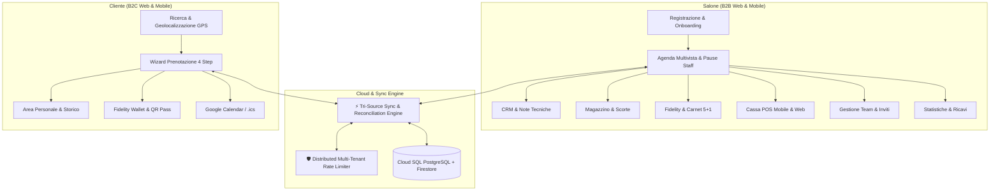

# ✂️ Trimmy — Piattaforma SaaS per Saloni & Portale Marketplace

> **Piattaforma SaaS Multi-Tenant Cloud-Native & App Mobile Cross-Platform** per acconciatori, barbieri e centri estetici.  
> Unisce un potente **gestionale per saloni** (agenda multivista, magazzino prodotti, CRM clienti con note tecniche, fidelity system con carnet, statistiche e gestione staff) con un'**esperienza marketplace e mobile per i clienti** (geolocalizzazione GPS "Vicino a me", booking wizard in 4 step, fidelity wallet stile Apple Wallet, integrazione calendari e QR code cassa).

---

## 🌐 Informazioni Live & Infrastruttura Cloud

- 🚀 **Web App Live**: [https://trimmy--gestionale-saloni.europe-west4.hosted.app](https://trimmy--gestionale-saloni.europe-west4.hosted.app)
- ☁️ **Infrastruttura**:
  - **Hosting Frontend/Backend Web**: [Firebase App Hosting](https://firebase.google.com/docs/app-hosting) su Google Cloud Run (`europe-west4`).
  - **Applicazione Mobile**: [Flutter](https://flutter.dev) per iOS e Android con supporto offline e architettura MVVM.
  - **Database Relazionale**: [Firebase Data Connect](https://firebase.google.com/docs/data-connect) con [Google Cloud SQL PostgreSQL](https://cloud.google.com/sql/docs/postgres) (`europe-west8`).
  - **Database Documentale NoSQL**: [Cloud Firestore](https://firebase.google.com/docs/firestore) (`europe-west4`) con real-time listeners (`onSnapshot`).
  - **Identity & Access Management**: [Firebase Authentication](https://firebase.google.com/docs/auth) (Google Sign-In + Email/Password con routing basato sui ruoli).
  - **Crash Reporting & Monitoraggio**: [Firebase Crashlytics](https://firebase.google.com/docs/crashlytics).

---

## 📌 Indice dei Contenuti

1. [Panoramica del Progetto](#-panoramica-del-progetto)
2. [Funzionalità Lato Salone (Gestionale SaaS B2B)](#-funzionalità-lato-salone-gestionale-saas-b2b)
3. [Funzionalità Lato Cliente (Marketplace B2C & Area Personale)](#-funzionalità-lato-cliente-marketplace-b2c--area-personale)
4. [Applicazione Mobile Nativa (Flutter per iOS & Android)](#-applicazione-mobile-nativa-flutter-per-ios--android)
5. [Architettura Tri-Source Sync, Resilienza & Real-Time](#-architettura-tri-source-sync-resilienza--real-time)
6. [Modello Dati & Database Schema](#-modello-dati--database-schema)
7. [Sicurezza, Rate Limiting & Isolamento Multi-Tenant](#-sicurezza-rate-limiting--isolamento-multi-tenant)
8. [Piani di Abbonamento & Gating](#-piani-di-abbonamento--gating)
9. [Sistema di Notifiche Multi-Canale (SMS & WhatsApp)](#-sistema-di-notifiche-multi-canale-sms--whatsapp)
10. [Conformità Legale & Fiscale (GDPR)](#-conformità-legale--fiscale-gdpr)
11. [Struttura del Progetto](#-struttura-del-progetto)
12. [Avvio e Sviluppo Locale](#-avvio-e-sviluppo-locale)
13. [Comandi di Deploy e Gestione Cloud](#-comandi-di-deploy-e-gestione-cloud)
14. [Compatibilità Browser & Dispositivi](#-compatibilità-browser--dispositivi)
15. [Roadmap di Sviluppo](#-roadmap-di-sviluppo)

---

## 💡 Panoramica del Progetto

**Trimmy** è concepito con un approccio omnicanale e sincronizzato a doppio fronte:



---

## 🏢 Funzionalità Lato Salone (Gestionale SaaS B2B)

### 1. 📅 Agenda Multivista Sincronizzata
- **4 Modalità di Visualizzazione**:
  - **Giornaliera**: Time-slot orari dalle 08:00 alle 20:00 con posizionamento dinamico e indicazione visiva dello stato.
  - **Settimanale**: Panoramica a 7 giorni per pianificare i carichi di lavoro.
  - **Mensile**: Griglia calendario con badge numerici degli appuntamenti giornalieri.
  - **Vista Staff / Operatori**: Colonne parallele per ogni collaboratore per gestire sovrapposizioni e postazioni.
- **Orari di Lavoro, Festività & Pause**: Supporto orari settimanali del salone, blocco giorni festivi o di chiusura e definizione pause o ferie dei collaboratori.
- **Creazione Rapida Appuntamenti**: Assegnazione istantanea di cliente, operatore, servizio, orario e note.
- **Auto-Provisioning Cliente**: Se il cliente non è presente in anagrafica al momento dell'inserimento in agenda, il sistema genera automaticamente la scheda anagrafica.

### 2. 👥 CRM Clienti Multi-Tenant Isolato
- **Schede Anagrafiche Dettagliate**: Nome, cognome, recapito telefonico con prefisso internazionale, email, compleanno e **note tecniche** (formule colore applicato, sfumatura preferita, sensibilità o allergie).
- **Storico Trattamenti**: Tracciamento di tutte le visite passate e future con stato (*Confermato*, *Completato*, *Annullato*).
- **Ricerca & Filtri Rapidi**: Ricerca istantanea per nome, cognome o recapito telefonico.

### 3. ✂️ Listino Trattamenti & Servizi
- **Catalogazione per Categorie**: Taglio & Piega, Colorazione, Trattamenti Curativi, Estetica.
- **Configurazione Dati**: Denominazione, durata in minuti, tariffa in Euro (€) e descrizione tecnica.
- **Persistenza Real-Time**: Salvataggio ibrido sincrono su Cloud Firestore e LocalStorage.

### 4. 📦 Magazzino & Gestione Scorte (`/magazzino`)
- **Tracciamento Giacenze**: Monitoraggio giacenza prodotti retail (vendita al pubblico) e ad uso professionale interno.
- **Decremento Automatico alla Cassa**: Scalamento automatico della giacenza al completamento del servizio o alla vendita diretta.
- **Audit Log Movimenti**: Tracciamento di carichi, scarichi, vendite e rettifiche inventariali con data, quantità e autore.
- **Alert Scorte Basse**: Evidenziazione visiva immediata quando la quantità scende sotto la soglia minima di sicurezza.

### 5. 💎 Sistema Fidelity, Tier VIP & Carnet Trattamenti
- **Punti Fedeltà**: Accumulo automatico punti ad ogni spesa e categorizzazione dei clienti in livelli VIP (*Bronze*, *Silver*, *Gold*, *Diamond*).
- **Carnet Prepagati**: Gestione pacchetti trattamenti (es. formula 5+1 con monitoraggio grafico delle sedute residue).
- **Riscatto alla Cassa**: Selezione immediata di sconti o utilizzo delle sedute del carnet al momento del pagamento.

### 6. 🎨 Personalizzazione Brand & Aspetto Salone
- **Dark Mode Avanzato**: Modalità Chiara, Scura o Sistema con script SSR inline zero-flicker e toggle rapido nell'header.
- **Palette Cromatiche Esclusive**: Scelta tra 6 combinazioni lusso (Obsidian Black, Warm Gold, Botanic Emerald, Royal Indigo, Sunset Coral, Rose Velvet).

### 7. 👨‍💼 Gestione Team & Staff con Gating Abbonamento
- **Invito Collaboratori**: Invio di email reale con Magic Link tramite Firebase Authentication e condivisione su WhatsApp.
- **Controllo Limiti del Piano**: Starter (1 operatore/titolare), Medium (fino a 3 operatori), Pro (collaboratori illimitati).

### 8. 📊 Statistiche & Analytics Aziendali
- **Dashboard Metriche (Recharts)**: Fatturato complessivo, scontrino medio, appuntamenti completati, clienti attivi e tasso di cancellazione.
- **Grafici Dinamici**: *AreaChart* per andamento ricavi nel tempo e *BarChart* per servizi più venduti.
- **Filtri Temporali**: Oggi, Ultimi 7 Giorni, Ultimi 30 Giorni e Anno Corrente.

---

## 💎 Funzionalità Lato Cliente (Marketplace B2C & Area Personale)

### 1. 🔍 Marketplace & Ricerca Intelligente
- **Autocompletamento Avanzato**: Ricerca istantanea per nome salone, categoria, città o singolo trattamento offerto.
- **Geolocalizzazione GPS "Vicino a me"**: Calcolo della distanza chilometrica reale tramite algoritmo Haversine e ordinamento saloni per prossimità.
- **Salvataggio Preferiti**: Salvataggio rapido con icona a cuore persistente nel profilo utente.

### 2. ✨ Wizard di Prenotazione in 4 Passaggi
1. **Scelta del Servizio**: Selezione dal listino verificato con prezzi e tempi trasparenti.
2. **Selezione Operatore**: Scelta del professionista preferito o assegnazione libera al primo disponibile.
3. **Data e Slot Orario**: Selezione del giorno con disponibilità orarie calcolate in tempo reale (escludendo chiusure e pause).
4. **Riepilogo e Conferma**: Notifica immediata al salone e inserimento istantaneo dell'appuntamento in agenda.

### 3. 👤 Area Personale & Fidelity Wallet
- **VIP Boarding Pass Card**: Visualizzazione chiara dell'appuntamento imminente con conto alla rovescia, dettagli indirizzo e operatore.
- **Tessera Fedeltà Apple Wallet Style**: Saldo punti VIP, barra avanzamento livello e visualizzazione carnet attivi.
- **QR Code Check-in**: Generazione QR Code da scansionare al banco per registrazione rapida e scalamento carnet.
- **Disdetta & Riprenotazione**: Annullamento con 1 click e rilascio immediato dello slot orario per il salone.
- **Sincronizzazione Calendario**: Aggiunta con 1 click a Google Calendar e download file `.ics`.

---

## 📱 Applicazione Mobile Nativa (Flutter per iOS & Android)

La directory [`Frontend/`](Frontend/) ospita l'applicazione mobile nativa sviluppata in **Flutter & Dart** secondo l'architettura raccomandata da Google (**MVVM + Repository Pattern**):

* **Multi-Ruolo Unificato**: Schermate dedicate per i Clienti (Marketplace, Wizard, Boarding Pass, Fidelity Wallet) e per i Saloni (Touch Agenda con swipe e bolle settimanali, Cassa POS Mobile, CRM Clienti).
* **Switch Rapido Ruolo**: Floating Action Button per testare istantaneamente sia la vista B2B che la vista B2C.
* **Geolocalizzazione & GPS**: Permessi runtime e calcolo prossimità tramite package `geolocator`.
* **Integrazione Firebase Nativa**: Firebase Core, Auth, Firestore e Crashlytics configurati su Android (`google-services.json`) e iOS (`GoogleService-Info.plist`).
* **Offline-Ready & Storage**: Persistenza locale con `shared_preferences` e `ApiClient` resiliente con retry policy.
* **QR Code Check-in**: Generazione e rendering istantaneo dei codici per il POS con `qr_flutter`.

---

## 🗄️ Architettura Tri-Source Sync, Resilienza & Real-Time

Trimmy adotta un'architettura **Tri-Source** progettata per azzerare la latenza percepita dall'utente, garantire l'aggiornamento simultaneo tra web app e app mobile e resistere a disconnessioni di rete:

```mermaid
graph TD
    UI[Web App / Mobile App]
    AS[appointments-service.ts / ApiClient]

    UI -->|Azione Utente| AS

    subgraph "Tri-Source Storage"
        AS -->|"1. Scrittura Real-Time"| FS[(Cloud Firestore)]
        AS -->|"2. Scrittura Relazionale"| DC[Data Connect GraphQL]
        AS -->|"3. Cache Ultra-Rapida"| LS[(LocalStorage / SharedPreferences)]
        DC --> CloudSQL[(Cloud SQL PostgreSQL)]
    end

    subgraph "Resilienza & Sincronizzazione"
        AS -->|"Outbox Queue"| OQ[Outbox Retry Queue]
        OQ -->|"Riconciliazione"| REC[/api/sync/reconcile]
        REC -->|"Last-Write-Wins"| FS
        FS -->|"Listener onSnapshot"| EB[Event Bus & State]
        EB -->|"Ricarica Istantanea"| Agenda[Agenda Salone]
        EB -->|"Ricarica Istantanea"| AreaCliente[Area Cliente & Wallet]
    end
```

### Principi di Resilienza:
1. **Scrittura Parallela**: Ogni operazione viene scritta contemporaneamente nella sottocollezione del salone (`/saloni/{tenantId}/*`), nella vista globale Firestore, in Cloud SQL PostgreSQL e nella cache locale (0 ms di latenza percepita).
2. **Outbox Retry Queue & Riconciliazione (`/api/sync/reconcile`)**: Le mutazioni offline o fallite vengono accodate e rieseguite con risoluzione conflitti basata su timestamp *Last-Write-Wins* e supporto a soft delete.
3. **Event Bus Interno**: Aggiornamento reattivo istantaneo delle viste senza ricaricamento della pagina.

---

## 🗃️ Modello Dati & Database Schema

Il database relazionale gestito da **Firebase Data Connect** su **Cloud SQL PostgreSQL** definisce in `dataconnect/schema/schema.gql`:

```graphql
# 1. I Saloni (Tenants)
type Tenant @table {
  id: UUID! @default(expr: "uuidV4()")
  name: String!
  planType: String! @default(value: "FREE")
  businessCategory: String
  onboardingCompleted: Boolean @default(value: false)
  createdAt: Timestamp! @default(expr: "request.time")
}

# 2. Gli Utenti / Staff (collegati a Firebase Auth)
type User @table {
  id: String! 
  tenant: Tenant!
  role: String! 
  fullName: String!
  phone: String
}

# 3. I Clienti (CRM del salone)
type Customer @table {
  id: UUID! @default(expr: "uuidV4()")
  tenant: Tenant!
  firstName: String!
  lastName: String!
  phone: String!
  email: String
  birthday: String
  technicalNotes: String
}

# 4. Il Listino Servizi
type Service @table {
  id: UUID! @default(expr: "uuidV4()")
  tenant: Tenant!
  name: String!
  durationMinutes: Int!
  price: Float!
}

# 5. Gli Appuntamenti
type Appointment @table {
  id: UUID! @default(expr: "uuidV4()")
  tenant: Tenant!
  customer: Customer!
  staff: User!
  service: Service!
  startTime: Timestamp!
  endTime: Timestamp!
  status: String! @default(value: "CONFIRMED") 
}
```

---

## 🔒 Sicurezza, Rate Limiting & Isolamento Multi-Tenant

- **Isolamento Rigoroso**: Ogni salone possiede un proprio identificativo univoco (`tenantId`). Tutte le operazioni di lettura e scrittura su database relazionale e Firestore includono il filtro obbligatorio sul tenant.
- **Distributed Multi-Tenant Rate Limiter**: Rate limiter multi-tenant per Google Cloud Run implementato mediante transazioni atomiche Firestore e fallback memory fail-open (protezione da attacchi brute force e saturazione quote).
- **Regole di Sicurezza Firestore (`firestore.rules`)**: Granulari e verificate per impedire accessi incrociati tra tenant differenti e garantire la riservatezza delle anagrafiche clienti.

---

## 💳 Piani di Abbonamento & Gating

| Piano | Prezzo Mensile | Prezzo Annuale (-20%) | Postazioni / Collaboratori | Notifiche SMS & WhatsApp | Funzionalità Incluse |
| :--- | :---: | :---: | :---: | :---: | :--- |
| **Starter** | **0,00 €** | **0,00 €** | **1 Operatore** (Titolare) | **Click-to-Chat Illimitato** (0 auto) | Agenda base, CRM clienti, magazzino base, QR Code, WhatsApp 1-click |
| **Medium** | **11,99 €** /mese | **115,99 €** /anno | **Fino a 3 Operatori** | **50 messaggi auto/mese** | Agenda multivista, promemoria automatici, note tecniche avanzate, scorte |
| **Pro** | **39,00 €** /mese | **374,40 €** /anno | **Illimitati (4+)** | **250 messaggi auto/mese** | Collaboratori illimitati, statistiche avanzate, carnet VIP, priorità delivery |

---

## 💬 Sistema di Notifiche Multi-Canale (SMS & WhatsApp)

Trimmy include un'architettura completa per la messaggistica verso i clienti del salone:

1. **Invio Diretto Gratuito (Click-to-Chat `https://wa.me/`):**
   - Disponibile per **tutti i piani (incluso Starter / Free)** senza costi aggiuntivi.
   - Dai dettagli cliente nel CRM, dall'agenda o dal registro log, il personale può aprire WhatsApp Web o l'app nativa con messaggio pre-compilato con un tocco.
2. **Gateway Serverless Automatico (`/api/notifications/send` & `/api/notifications/cron`):**
   - Integrato con Twilio SMS e Twilio WhatsApp Messaging Service.
   - **Sandbox Simulator automatico**: in assenza di credenziali Twilio nel file `.env.local`, il sistema simula l'invio istantaneo registrando i log su Firestore senza generare errori o costi.
   - Supporto a 4 tipologie di evento: Conferma immediata, Promemoria a 24h/12h, Cancellazione e Richiesta recensione 5 stelle post-servizio.

---

## ⚖️ Conformità Legale & Fiscale (GDPR)

La piattaforma include sezioni legali dedicate e aggiornate:
* **Privacy Policy (`/privacy`)**: Trattamento dei dati personali conforme al Regolamento UE 2016/679 (GDPR), diritti degli interessati, finalità di contatto e misure di sicurezza applicate.
* **Termini e Condizioni di Servizio (`/termini`)**: Disciplina dei contratti SaaS e clausola di **esonero da responsabilità fiscale**, esplicitando che Trimmy è uno strumento gestionale/organizzativo e non sostituisce il Registratore Telematico o gli obblighi di emissione del documento commerciale a carico del salone.

---

## 📁 Struttura del Progetto

```text
Trimmy/
├── README.md                                 # Documentazione master del progetto
├── Backend/
│   ├── firebase.json                         # Configurazione Firebase App Hosting, Firestore e Data Connect
│   ├── firestore.rules                       # Regole di sicurezza granulari per Cloud Firestore
│   ├── apphosting.yaml                       # Risorse Cloud Run e parametri di scaling
│   ├── dataconnect/
│   │   ├── dataconnect.yaml                  # Configurazione del connettore PostgreSQL
│   │   ├── schema/
│   │   │   └── schema.gql                    # Schema GraphQL / PostgreSQL
│   │   └── example/
│   │       ├── connector.yaml                # Generazione SDK TypeScript
│   │       ├── queries.gql                   # Query appuntamenti, clienti, servizi e tenant
│   │       └── mutations.gql                 # Mutazioni CRUD
│   └── web-app/                              # Applicazione Next.js 16 (App Router)
│       ├── package.json
│       ├── next.config.ts
│       ├── README.md                         # Documentazione specifica della web-app
│       └── src/
│           ├── app/
│           │   ├── (dashboard)/              # Portale Gestionale Salone
│           │   │   ├── page.tsx              # Agenda multivista e gestione orari
│           │   │   ├── clienti/page.tsx      # CRM clienti con note tecniche
│           │   │   ├── trattamenti/page.tsx  # Catalogo listino prezzi e durata
│           │   │   ├── magazzino/page.tsx    # Inventario prodotti, scorte e audit log
│           │   │   ├── statistiche/page.tsx  # Analytics con grafici Recharts
│           │   │   └── impostazioni/page.tsx # Brand, Team, Notifiche & SMS, Abbonamento
│           │   ├── api/                      # Endpoint Serverless Node.js
│           │   │   ├── notifications/send/   # Invio transazionale SMS/WhatsApp
│           │   │   ├── notifications/cron/   # Job periodico per promemoria automatici
│           │   │   └── sync/reconcile/       # Riconciliazione Tri-Source resiliente
│           │   ├── privacy/page.tsx          # Informativa Privacy GDPR
│           │   ├── termini/page.tsx          # Termini d'Uso con clausola fiscale
│           │   ├── cliente/page.tsx          # Portale Cliente & Marketplace
│           │   └── prenota/page.tsx          # Prenotazione diretta via QR Code
│           └── components/
│               ├── Sidebar.tsx               # Navigazione principale del gestionale
│               ├── ThemeProvider.tsx         # Gestione Dark Mode, zero-flicker SSR e palette
│               ├── NotificationBell.tsx      # Notifiche in-app in tempo reale
│               └── HeaderSearch.tsx          # Barra di ricerca globale intelligente
└── Frontend/                                 # 📱 Applicazione Mobile Nativa (Flutter)
    ├── pubspec.yaml
    ├── README.md                             # Documentazione specifica dell'app mobile
    ├── android/                              # Progetto Android con google-services.json
    ├── ios/                                  # Progetto iOS con GoogleService-Info.plist
    └── lib/
        ├── main.dart                         # Entry point e MultiProvider
        ├── firebase_options.dart             # Opzioni multipiattaforma Firebase
        ├── core/
        │   ├── network/api_client.dart       # HTTP Client con token e retry
        │   ├── services/location_service.dart# GPS runtime & prossimità Haversine
        │   └── theme/                        # Design System Material 3 di lusso
        ├── data/
        │   ├── models/                       # Modelli Dart (User, Salon, Appointment, Fidelity)
        │   └── repositories/                 # Repositories persistenti
        └── ui/
            ├── auth/login_screen.dart        # Login e switch rapido demo
            ├── client/                       # Hub Cliente, Marketplace, Wizard, Fidelity Wallet
            └── salon/                        # Hub Salone, Touch Agenda, Mobile POS, CRM
```

---

## 💻 Avvio e Sviluppo Locale

### 1. Web App (Next.js 16)
```bash
cd Backend/web-app
npm install
npm run dev
```

### 2. Mobile App (Flutter)
```bash
cd Frontend
flutter pub get
flutter run
```

---

## 🚀 Comandi di Deploy e Gestione Cloud

```bash
cd Backend

# 1. Deploy Applicazione Web (Firebase App Hosting)
npx -y firebase-tools deploy --only apphosting --project gestionale-saloni

# 2. Deploy Regole di Sicurezza Firestore
npx -y firebase-tools deploy --only firestore:rules --project gestionale-saloni

# 3. Deploy Connettori & Schema PostgreSQL (Firebase Data Connect)
npx -y firebase-tools deploy --only dataconnect:gestionale-saloni-service:gestionale --project gestionale-saloni
```

---

## 🌐 Compatibilità Browser & Dispositivi

| Piattaforma | Versione / Modello | Stato |
| :--- | :--- | :---: |
| **Google Chrome / Chromium** | 90+ | ✅ Pieno Supporto |
| **Apple Safari (macOS / iOS)** | 15+ | ✅ Pieno Supporto |
| **Mozilla Firefox** | 90+ | ✅ Pieno Supporto |
| **Microsoft Edge** | 90+ | ✅ Pieno Supporto |
| **Android Nativo (Flutter)** | Android 7.0+ (API 24+) | ✅ Pieno Supporto |
| **iOS Nativo (Flutter)** | iOS 13+ | ✅ Pieno Supporto |

---

## 📱 Roadmap di Sviluppo

- [x] Autenticazione unificata Google & Email/Password con routing automatico dei ruoli
- [x] Agenda multivista: Giornaliera, Settimanale, Mensile e Vista Staff
- [x] Auto-provisioning anagrafica clienti durante l'inserimento appuntamenti
- [x] CRM clienti multi-tenant isolato con note tecniche e storico visite
- [x] Sincronizzazione dati Tri-Source (Firestore + Data Connect PostgreSQL + LocalStorage)
- [x] Riconciliazione dati resiliente (`/api/sync/reconcile`) con outbox retry queue e timestamp Last-Write-Wins
- [x] Rate limiter distribuito multi-tenant per Cloud Run su Firestore
- [x] Magazzino prodotti & inventario con decremento automatico alla cassa e audit log
- [x] Sistema fedeltà con Tier VIP e Carnet trattamenti prepagati (5+1)
- [x] Personalizzazione Brand e Dark Mode con script zero-flicker SSR
- [x] Notifiche automatiche SMS & WhatsApp (Twilio + Click-to-Chat + Sandbox Simulator + Cron)
- [x] Marketplace clienti con geolocalizzazione GPS "Vicino a me"
- [x] Wizard di prenotazione cliente in 4 passaggi con calcolo slot in tempo reale
- [x] Sincronizzazione calendari esterni (Google Calendar e download file `.ics`)
- [x] Generatore di QR Code e link dedicati per il bancone del salone
- [x] Dashboard statistiche con grafici Recharts su fatturato, clienti e servizi
- [x] **Sviluppo Applicazione Mobile Android/iOS (Flutter)** nella cartella `Frontend/` con Touch Agenda, POS Mobile e Fidelity Wallet
- [x] Integrazione Firebase nativa su Android e iOS (`google-services.json`, `GoogleService-Info.plist`, Crashlytics)
- [x] Pagine legali GDPR (Privacy Policy & Termini di Servizio con clausola fiscale)
- [x] Ottimizzazione grafica sidebar e dark mode switcher nell'header
- [ ] Mappa Interattiva Google Maps integrata nel Marketplace (prevista in upgrade futuro)
- [ ] Integrazione gateway di pagamento online (Stripe Checkout) per caparra/pagamento anticipato
