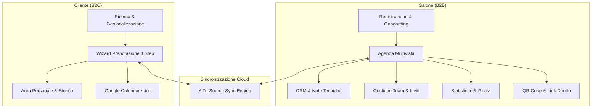
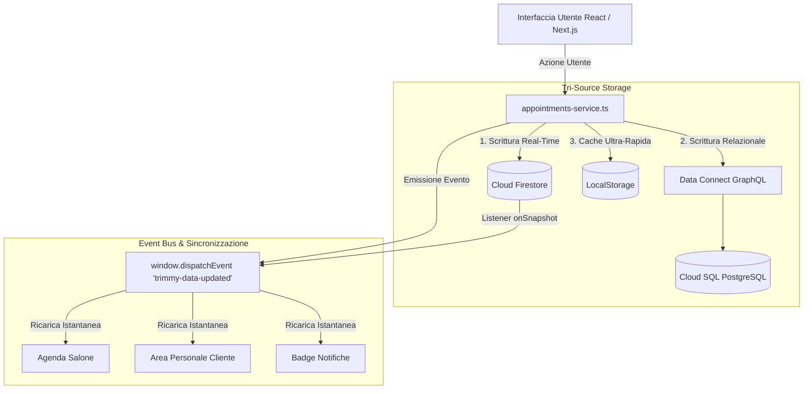

# ✂️ Trimmy — Piattaforma SaaS per Saloni & Portale Marketplace

> **Piattaforma SaaS Multi-Tenant Cloud-Native** per acconciatori, barbieri e centri estetici.  
> Unisce un potente **gestionale per saloni** (agenda multivista, CRM clienti isolato, statistiche, gestione collaboratori e listini) con un **marketplace e portale di prenotazione per i clienti** (geolocalizzazione "Vicino a me", booking wizard in 4 step, integrazione con calendari e QR code).

---

## 🌐 Informazioni Live & Infrastruttura Cloud

- 🚀 **Web App Live**: [https://trimmy--gestionale-saloni.europe-west4.hosted.app](https://trimmy--gestionale-saloni.europe-west4.hosted.app)
- ☁️ **Infrastruttura**:
  - **Hosting Frontend/Backend**: [Firebase App Hosting](https://firebase.google.com/docs/app-hosting) su Google Cloud Run (`europe-west4`).
  - **Database Relazionale**: [Firebase Data Connect](https://firebase.google.com/docs/data-connect) con [Google Cloud SQL PostgreSQL](https://cloud.google.com/sql/docs/postgres) (`europe-west8`).
  - **Database Documentale NoSQL**: [Cloud Firestore](https://firebase.google.com/docs/firestore) (`europe-west4`) con real-time listeners (`onSnapshot`).
  - **Identity & Access Management**: [Firebase Authentication](https://firebase.google.com/docs/auth) (Google Sign-In + Email/Password con routing basato sui ruoli).

---

## 📌 Indice dei Contenuti

1. [Panoramica del Progetto](#-panoramica-del-progetto)
2. [Funzionalità Lato Salone (Gestionale SaaS B2B)](#-funzionalità-lato-salone-gestionale-saas-b2b)
3. [Funzionalità Lato Cliente (Marketplace B2C & Area Personale)](#-funzionalità-lato-cliente-marketplace-b2c--area-personale)
4. [Architettura Tri-Source Sync & Real-Time](#-architettura-tri-source-sync--real-time)
5. [Modello Dati & Database Schema](#-modello-dati--database-schema)
6. [Sicurezza e Isolamento Multi-Tenant](#-sicurezza-e-isolamento-multi-tenant)
7. [Piani di Abbonamento & Gating](#-piani-di-abbonamento--gating)
8. [Struttura del Progetto](#-struttura-del-progetto)
9. [Avvio e Sviluppo Locale](#-avvio-e-sviluppo-locale)
10. [Comandi di Deploy e Gestione Cloud](#-comandi-di-deploy-e-gestione-cloud)
11. [Compatibilità Browser & Piattaforme](#-compatibilità-browser--piattaforme)
12. [Roadmap di Sviluppo](#-roadmap-di-sviluppo)

---

## 💡 Panoramica del Progetto

**Trimmy** è concepito con un approccio a doppio fronte per risolvere l'intero ciclo di vita dell'esperienza salone:



---

## 🏢 Funzionalità Lato Salone (Gestionale SaaS B2B)

### 1. 📅 Agenda Multivista Sincronizzata
- **4 Modalità di Visualizzazione**:
  - **Giornaliera**: Time-slot orari dalle 08:00 alle 20:00 con posizionamento dinamico e indicazione visiva dello stato.
  - **Settimanale**: Panoramica a 7 giorni per pianificare i carichi di lavoro.
  - **Mensile**: Griglia calendario con badge numerici degli appuntamenti giornalieri.
  - **Vista Staff / Operatori**: Colonne parallele per ogni collaboratore per gestire le sovrapposizioni e le postazioni contemporanee.
- **Creazione Rapida Appuntamenti**: Assegnazione istantanea di cliente, operatore, servizio, orario e note.
- **Auto-Provisioning Cliente**: Se il cliente non è presente in anagrafica al momento dell'inserimento manuale in agenda, il sistema genera automaticamente l'anagrafica cliente collegata senza interrompere il flusso.

### 2. 👥 CRM Clienti Multi-Tenant Isolato
- **Schede Anagrafiche Dettagliate**: Nome, cognome, recapito telefonico, indirizzo email, data di compleanno e **note tecniche** (es. colore applicato, sfumatura preferita, sensibilità o allergie cutanee).
- **Storico Trattamenti**: Tracciamento di tutte le visite passate e future con stato (*Confermato*, *Completato*, *Annullato*).
- **Ricerca & Filtri Rapidi**: Ricerca istantanea per nome, cognome o recapito telefonico.

### 3. ✂️ Listino Trattamenti & Servizi
- **Catalogazione per Categorie**: Taglio & Piega, Colorazione, Trattamenti Curativi, Estetica.
- **Configurazione Dati**: Denominazione, durata in minuti, tariffa in Euro (€) e descrizione tecnica.
- **Persistenza Real-Time**: Salvataggio ibrido sincrono su Cloud Firestore e LocalStorage: modifiche e cancellazioni persistono all'aggiornamento pagina (F5).

### 4. 👨‍💼 Gestione Team & Staff con Gating Abbonamento
- **Invito Collaboratori**:
  - Invio di **email reale** con Magic Link tramite Firebase Authentication.
  - Generazione di link di adesione rapido con copia negli appunti e condivisione su **WhatsApp**.
- **Controllo Gated sui Limiti del Piano**:
  - *Starter*: 1 operatore (il titolare).
  - *Medium*: fino a 3 operatori.
  - *Pro*: collaboratori illimitati.
  - Se il salone tenta di inserire più collaboratori di quelli previsti, si attiva un modal di blocco con redirect diretto all'upgrade.

### 5. 📊 Statistiche & Analytics Aziendali
- **Dashboard Metriche (con Recharts)**:
  - Fatturato complessivo maturato e scontrino medio.
  - Volume totale appuntamenti completati e tasso di cancellazione.
  - Numero clienti attivi registrati.
- **Grafici Dinamici**:
  - *AreaChart*: andamento del fatturato nel tempo.
  - *BarChart*: scomposizione delle entrate per servizio/trattamento.
- **Filtri Temporali**: Visualizzazione per "Oggi", "Ultimi 7 Giorni", "Ultimi 30 Giorni" e "Anno Corrente".

### 6. ⚙️ Profilo Aziendale & Gestione Abbonamento
- Configurazione sede operativa (Indirizzo, Città, Zona, Categoria, Telefono, Orari di apertura).
- Coordinate geografiche calcolate per l'esposizione automatica sul Marketplace.
- Gestione piano SaaS (Free/Starter, Medium, Pro) con possibilità di switch mensile o annuale (-20%).
- Notifiche in-app in tempo reale per appuntamenti, cancellazioni o promemoria.

---

## 💎 Funzionalità Lato Cliente (Marketplace B2C & Area Personale)

### 1. 🔍 Marketplace & Ricerca Intelligente
- **Autocompletamento Avanzato**: Ricerca istantanea per nome salone, categoria, città o singolo trattamento offerto.
- **Filtro Geolocalizzato "Vicino a me"**: Calcolo della distanza in km dalla posizione GPS del browser tramite algoritmo Haversine, con riordinamento dinamico dei saloni dal più vicino al più lontano.
- **Salvataggio Saloni Preferiti**: Salvataggio rapido con icona a cuore persistente nel profilo utente.

### 2. 📍 Geolocalizzazione & Prossimità
- **Distanza Reale e Algoritmo Haversine**: Calcolo istantaneo dei chilometri di distanza da ciascun salone rispetto alla posizione del cliente.
- **Ordinamento Intelligente per Distanza**: Ordinamento con un click per visualizzare per primi i saloni più vicini.

### 3. ✨ Wizard di Prenotazione in 4 Passaggi
1. **Scelta del Servizio**: Selezione dal listino verificato con prezzi e tempi trasparenti.
2. **Selezione Operatore**: Scelta del professionista preferito o assegnazione libera al primo disponibile.
3. **Data e Slot Orario**: Selezione del giorno e orari liberi calcolati in tempo reale sulle disponibilità effettive dell'agenda.
4. **Riepilogo e Conferma**: Notifica immediata al salone e inserimento istantaneo dell'appuntamento in agenda.

### 4. 👤 Area Personale Cliente
- **VIP Boarding Pass Card**: Visualizzazione chiara dell'appuntamento imminente con conto alla rovescia, dettagli indirizzo e operatore.
- **Disdetta & Riprenotazione**: Annullamento dell'appuntamento con 1 click (con rilascio slot orario per il salone) e funzione *"Riprenota al volo"*.
- **Note di Bellezza**: Sezione dedicata in cui il cliente annota preferenze di taglio, colore, barba o prodotti preferiti.
- **Recensioni a 5 Stelle**: Modal per lasciare feedback e recensioni al termine del servizio.

### 5. 📆 Calendari & Accesso Rapido
- **Sincronizzazione Calendario**: Aggiunta con 1 click a **Google Calendar** e download file standard **.ics** (compatibile con Apple Calendar e Microsoft Outlook).
- **QR Code & Link Diretto (`/prenota?salone=...`)**: Generazione automatica di QR Code da stampare per il bancone del salone, consentendo ai clienti di prenotare dal proprio smartphone in pochi secondi.

---

## 🗄️ Architettura Tri-Source Sync & Real-Time

Trimmy adotta un'architettura **Tri-Source** (tre fonti sincronizzate) progettata per azzerare la latenza percepita dall'utente, garantire l'aggiornamento simultaneo di clienti e saloni e resistere a disconnessioni di rete:



### Principi di Funzionamento:
1. **Scrittura Parallela**: Ogni nuovo appuntamento o modifica di stato viene scritta contemporaneamente su:
   - Sottocollezione Firestore del salone (`/saloni/{tenantId}/appuntamenti/{id}`).
   - Raccolta Firestore globale (`/appointments/{id}`) per la visibilità dell'area cliente.
   - Database relazionale Cloud SQL PostgreSQL tramite mutazione GraphQL autogenerata.
   - Storage locale per feedback immediato all'utente (0 ms latency).
2. **Lettura e Deduplicazione**: Le query interrogano Firestore e il database relazionale unificando i risultati ed eliminando duplicati per chiave univoca `id`.
3. **Event Bus Interno**: L'evento custom `trimmy-data-updated` notifica istantaneamente tutti i componenti React montati a schermo, eliminando la necessità di refresh della pagina.

---

## 🗃️ Modello Dati & Database Schema

Il database relazionale gestito da **Firebase Data Connect** su **Cloud SQL PostgreSQL** definisce le seguenti entità in `dataconnect/schema/schema.gql`:

```graphql
# 1. I Saloni (Tenants)
type Tenant @table {
  id: UUID! @default(expr: "uuidV4()")
  name: String!
  planType: String! @default(value: "FREE")
  businessCategory: String
  onboardingCompleted: Boolean @default(value: false)
  createdAt: Timestamp! @default(expr: "request.time")
}

# 2. Gli Utenti / Staff (collegati a Firebase Auth)
type User @table {
  id: String! 
  tenant: Tenant!
  role: String! 
  fullName: String!
  phone: String
}

# 3. I Clienti (CRM del salone)
type Customer @table {
  id: UUID! @default(expr: "uuidV4()")
  tenant: Tenant!
  firstName: String!
  lastName: String!
  phone: String!
  email: String
  birthday: String
  technicalNotes: String
}

# 4. Il Listino Servizi
type Service @table {
  id: UUID! @default(expr: "uuidV4()")
  tenant: Tenant!
  name: String!
  durationMinutes: Int!
  price: Float!
}

# 5. Gli Appuntamenti
type Appointment @table {
  id: UUID! @default(expr: "uuidV4()")
  tenant: Tenant!
  customer: Customer!
  staff: User!
  service: Service!
  startTime: Timestamp!
  endTime: Timestamp!
  status: String! @default(value: "CONFIRMED") 
}
```

---

## 🔒 Sicurezza e Isolamento Multi-Tenant

- **Isolamento Dati**: Ogni salone possiede un proprio identificativo univoco (`tenantId`). Tutte le operazioni di lettura e scrittura su database relazionale e Firestore includono il filtro obbligatorio sul tenant.
- **Mapping Duale**: Il sistema mappa sia il `tenantId` che il `Firebase Auth UID` del titolare per garantire la perfetta sincronizzazione tra le sessioni di login e i dati aziendali.
- **Regole di Sicurezza Firestore (`firestore.rules`)**: I saloni possono accedere esclusivamente ai documenti appartenenti alla propria directory `/saloni/{tenantId}/*`, mentre i clienti hanno accesso in lettura/scrittura solo ai propri appuntamenti e profili personali.

---

## 💳 Piani di Abbonamento & Gating

| Piano | Prezzo Mensile | Prezzo Annuale (-20%) | Postazioni / Collaboratori | Notifiche SMS & WhatsApp | Funzionalità Incluse |
| :--- | :---: | :---: | :---: | :---: | :--- |
| **Starter** | **0,00 €** | **0,00 €** | **1 Operatore** (Titolare) | **Click-to-Chat Illimitato** (0 auto) | Agenda base, CRM clienti, listino servizi, QR Code, WhatsApp 1-click |
| **Medium** | **11,99 €** /mese | **115,99 €** /anno | **Fino a 3 Operatori** | **50 messaggi auto/mese** | Agenda multivista, promemoria automatici, note tecniche avanzate |
| **Pro** | **39,00 €** /mese | **374,40 €** /anno | **Illimitati (4+)** | **250 messaggi auto/mese** | Collaboratori illimitati, statistiche avanzate, export, priorità delivery |

---

## 📁 Struttura del Progetto

```text
Gestionale saloni/
├── README.md                                 # Documentazione completa dell'intero progetto
├── Backend/
│   ├── firebase.json                         # Configurazione Firebase App Hosting, Firestore e Data Connect
│   ├── firestore.rules                       # Regole di sicurezza granulari per Cloud Firestore
│   ├── apphosting.yaml                       # Risorse Cloud Run e parametri di scaling
│   ├── dataconnect/
│   │   ├── dataconnect.yaml                  # Configurazione del connettore PostgreSQL
│   │   ├── schema/
│   │   │   └── schema.gql                    # Schema GraphQL / PostgreSQL
│   │   └── example/
│   │       ├── connector.yaml                # Generazione SDK TypeScript
│   │       ├── queries.gql                   # Query appuntamenti, clienti, servizi e tenant
│   │       └── mutations.gql                 # Mutazioni CRUD
│   └── web-app/                              # Applicazione Next.js 16 (App Router)
│       ├── package.json
│       ├── next.config.ts
│       └── src/
│           ├── app/
│           │   ├── (dashboard)/              # Portale Gestionale Salone (Layout protetto)
│           │   │   ├── page.tsx              # Agenda multivista (Giorno, Settimana, Mese, Staff) con WhatsApp Click-to-Chat
│           │   │   ├── clienti/page.tsx      # CRM clienti con note tecniche, storico e WhatsApp 1-click
│           │   │   ├── trattamenti/page.tsx  # Gestione listino prezzi e durata
│           │   │   ├── statistiche/page.tsx  # Analytics con grafici Recharts
│           │   │   └── impostazioni/page.tsx # Profilo salone, team, Notifiche & SMS, e abbonamento SaaS
│           │   ├── api/                      # Endpoint Serverless Node.js
│           │   │   └── notifications/
│           │   │       ├── send/route.ts     # Invio istantaneo SMS/WhatsApp via Twilio + Sandbox simulator
│           │   │       └── cron/route.ts     # Job schedulato per promemoria 24h e richieste recensioni
│           │   ├── login/page.tsx            # Accesso unificato Google e Email/Password
│           │   ├── onboarding/page.tsx       # Wizard configurazione iniziale del salone
│           │   ├── abbonamento-pro/page.tsx  # Flusso di upgrade piano SaaS
│           │   ├── cliente/page.tsx          # Portale Cliente, Marketplace & Storico
│           │   └── prenota/page.tsx          # Prenotazione diretta via QR Code o link
│           ├── components/
│           │   ├── BookingWizardModal.tsx    # Wizard prenotazione in 4 passaggi con info avvisi SMS/WhatsApp
│           │   ├── ClientSidebar.tsx         # Sidebar navigazione per area cliente
│           │   ├── HeaderSearch.tsx          # Barra ricerca smart con autocompletamento
│           │   ├── NotificationBell.tsx      # Centro notifiche in tempo reale
│           │   ├── ReviewModal.tsx           # Modale recensioni a 5 stelle
│           │   ├── SalonShareModal.tsx       # Modale condivisione e QR Code
│           │   └── Sidebar.tsx               # Sidebar principale del gestionale
│           ├── lib/
│           │   ├── firebase.ts               # Inizializzazione Firebase e Data Connect
│           │   ├── appointments-service.ts   # Core Tri-Source Sync + trigger notifiche automatiche
│           │   ├── customers-store.ts        # CRM multi-tenant con dual-mapping
│           │   ├── client-booking.ts         # Logica marketplace, prenotazioni e calendari
│           │   ├── notifications-types.ts    # Tipi notifiche, quote piani, template predefiniti
│           │   ├── notifications-service.ts  # Servizio client: normalizzazione telefoni, click-to-chat, invio e log
│           │   ├── salons-service.ts         # Fetch e normalizzazione saloni registrati
│           │   ├── staff-store.ts            # Gestione collaboratori e gating piano
│           │   ├── services-store.ts         # Persistenza listino trattamenti
│           │   ├── user-profile.ts           # Profilazione utente, quote SMS e calcolo piano
│           │   ├── tenant-helper.ts          # Gestione identificativi tenant
│           │   └── date-utils.ts             # Utility di parsing e formattazione date
│           └── dataconnect-generated/        # SDK client GraphQL autogenerato da Firebase
└── Frontend/                                 # 📱 Directory riservata all'App Mobile nativa
```

> 💡 **Nota sulla cartella `Frontend/`**: La directory `Frontend/` è predisposta per ospitare la futura **Applicazione Mobile nativa** (Android/iOS via Flutter o Kotlin), che si collegherà direttamente alla medesima infrastruttura Firebase Auth, Firestore e Data Connect già operativa.

---

## 💻 Avvio e Sviluppo Locale

### Prerequisiti
- **Node.js** v20 o superiore
- **npm** (incluso in Node.js)
- **Firebase CLI**: `npm install -g firebase-tools` oppure richiamabile tramite `npx firebase-tools`

### 1. Installazione Dipendenze
```bash
cd Backend/web-app
npm install
```

### 2. Configurazione Variabili d'Ambiente
Crea il file `.env.local` all'interno della cartella `Backend/web-app/`:
```env
NEXT_PUBLIC_FIREBASE_API_KEY=tuo_api_key
NEXT_PUBLIC_FIREBASE_AUTH_DOMAIN=gestionale-saloni.firebaseapp.com
NEXT_PUBLIC_FIREBASE_PROJECT_ID=gestionale-saloni
NEXT_PUBLIC_FIREBASE_STORAGE_BUCKET=gestionale-saloni.firebasestorage.app
NEXT_PUBLIC_FIREBASE_MESSAGING_SENDER_ID=tuo_sender_id
NEXT_PUBLIC_FIREBASE_APP_ID=tuo_app_id

# Opzionale: attiva la visualizzazione standard Google Maps
NEXT_PUBLIC_GOOGLE_MAPS_API_KEY=tua_google_maps_key

# Opzionale: Gateway SMS & WhatsApp (Twilio). In assenza di chiavi, il sistema opera in modalità Sandbox Simulator
TWILIO_ACCOUNT_SID=tuo_account_sid
TWILIO_AUTH_TOKEN=tuo_auth_token
TWILIO_PHONE_NUMBER=+1234567890
TWILIO_WHATSAPP_NUMBER=whatsapp:+14155238886
CRON_SECRET=stringa_segreta_autorizzazione_cron
```

### 3. Avvio dell'Ambiente di Sviluppo
```bash
cd Backend/web-app
npm run dev
```
L'applicazione risponderà all'indirizzo `http://localhost:3000`.

### 4. Rigenerazione SDK GraphQL (se si modificano i file `.gql`)
```bash
cd Backend
npx -y firebase-tools dataconnect:compile
```

---

## 🚀 Comandi di Deploy e Gestione Cloud

I deploy vengono effettuati direttamente tramite Firebase CLI senza dipendere da trigger remoti:

### 1. Deploy Applicazione Web (Firebase App Hosting)
```bash
cd Backend
npx -y firebase-tools deploy --only apphosting --project gestionale-saloni
```

### 2. Deploy Regole di Sicurezza Firestore
```bash
cd Backend
npx -y firebase-tools deploy --only firestore:rules --project gestionale-saloni
```

### 3. Deploy Connettori & Schema PostgreSQL (Firebase Data Connect)
```bash
cd Backend
npx -y firebase-tools deploy --only dataconnect:gestionale-saloni-service:gestionale --project gestionale-saloni
```

---

## 💬 Sistema di Notifiche Multi-Canale (SMS & WhatsApp)

Trimmy include un'architettura completa per la messaggistica verso i clienti del salone, progettata per operare sia a costo zero (tramite deep-link WhatsApp) sia in modalità automatizzata serverless (tramite gateway Twilio / Meta Cloud API con simulatore Sandbox integrato):

### 🌟 Architettura Ibrida a Doppio Livello
1. **Invio Diretto Gratuito (Click-to-Chat `https://wa.me/`):**
   - Disponibile per **tutti i piani (incluso Starter / Free)** senza costi per API esterne.
   - Dai dettagli cliente nel CRM, dall'agenda o dal registro log, il personale del salone può aprire WhatsApp Web o l'app nativa con messaggio pre-compilato con un solo click.
2. **Gateway Serverless Automatico (`/api/notifications/send` & `/api/notifications/cron`):**
   - Integrato con Twilio SMS e Twilio WhatsApp Messaging Service.
   - **Sandbox Simulator automatico**: in assenza di credenziali Twilio nel file `.env.local`, l'API non va in errore ma simula l'invio istantaneo, generando record persistenti su Firestore per collaudare l'esperienza end-to-end senza costi.

### 🔔 4 Tipologie di Notifica Supportate
| Evento | Trigger | Canale Predefinito | Descrizione |
| :--- | :--- | :---: | :--- |
| **Conferma Immediata** | Creazione appuntamento (da salone o cliente) | WhatsApp / SMS | Invia riepilogo con servizio, operatore, data e ora |
| **Promemoria Automatico** | Cron job (12h, 24h o 48h prima) | WhatsApp / SMS | Azzeramento dei no-show con dettagli e link salone |
| **Cancellazione / Spostamento** | Annullamento o cambio orario | WhatsApp / SMS | Avviso immediato con invito a riprenotare |
| **Richiesta Recensione 5 Stelle** | Appuntamento completato | WhatsApp | Invito a lasciare feedback e rating dopo il servizio |

### ⚙️ Pannello di Controllo in Salone (`Impostazioni -> Notifiche & SMS`)
- **Contatore Crediti e Quota Mensile**: Monitoraggio trasparente dei messaggi inviati nel mese in base al piano (`Starter`: 0 auto / Click-to-Chat illimitato, `Medium`: 50/mese, `Pro`: 250/mese).
- **Interruttori Canali Indipendenti**: Attivazione separata di WhatsApp e SMS.
- **Editor Template Messaggi**: Personalizzazione di tutti i testi con tag dinamici `{cliente}`, `{salone}`, `{servizio}`, `{data}`, `{ora}` e ripristino con 1-click ai default raccomandati.
- **Simulatore & Invio Test Istantaneo**: Invio di messaggi di prova verso qualsiasi cellulare per verificare la formattazione.
- **Registro Storico (Log)**: Cronologia degli invii con timestamp, destinatario, canale, tipologia, stato (`DELIVERED`, `SIMULATED`, `FAILED`) e scorciatoia diretta WhatsApp.

---

## 🌐 Compatibilità Browser & Piattaforme

Trimmy è progettato con pratiche moderne di web design responsive, garantendo supporto completo per:

| Browser | Versione Minima | Supporto |
| :--- | :---: | :---: |
| **Google Chrome** | 90+ | ✅ Completo |
| **Apple Safari** (macOS / iOS) | 15+ | ✅ Completo |
| **Mozilla Firefox** | 90+ | ✅ Completo |
| **Microsoft Edge** | 90+ | ✅ Completo |
| **Samsung Internet** | 15+ | ✅ Completo |

---

## 📱 Roadmap di Sviluppo

- [x] Autenticazione unificata Google & Email/Password con routing automatico dei ruoli
- [x] Agenda multivista: Giornaliera, Settimanale, Mensile e Vista Staff
- [x] Auto-provisioning anagrafica clienti durante l'inserimento appuntamenti
- [x] CRM clienti multi-tenant isolato con note tecniche e storico visite
- [x] Sincronizzazione dati Tri-Source (Firestore + Data Connect PostgreSQL + LocalStorage)
- [x] Gestione staff e collaboratori con gating automatico basato sui piani SaaS
- [x] Invito collaboratori tramite email reale e link rapido WhatsApp
- [x] Marketplace clienti con geolocalizzazione GPS "Vicino a me"
- [x] Wizard di prenotazione cliente in 4 passaggi con calcolo slot in tempo reale
- [x] Sincronizzazione calendari esterni (Google Calendar e download file `.ics`)
- [x] Generatore di QR Code e link dedicati per il bancone del salone
- [x] Dashboard statistiche con grafici Recharts su fatturato, clienti e servizi
- [x] Hosting in produzione su Firebase App Hosting (`europe-west4`)
- [x] Notifiche SMS / WhatsApp automatiche per conferma, promemoria programmato (12h/24h/48h), cancellazione e richiesta recensioni post-servizio
- [ ] Mappa Interattiva Google Maps (prevista in upgrade futuro)
- [ ] Integrazione gateway di pagamento online (Stripe Checkout) per caparra/pagamento anticipato
- [ ] **Sviluppo Applicazione Mobile Android/iOS** nella cartella `Frontend/` condividente le stesse API Cloud
